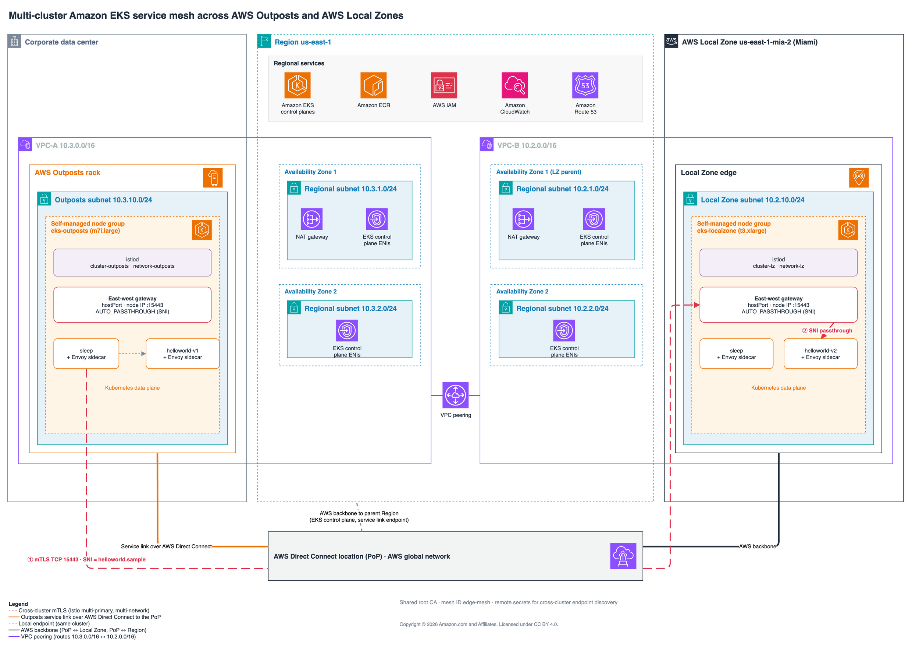

# Multi-cluster Amazon EKS service mesh across AWS Outposts and AWS Local Zones

Terraform for an Istio multi-primary, multi-network service mesh that spans two Amazon EKS clusters: one with
worker nodes on an AWS Outposts rack, one with worker nodes in an AWS Local Zone. Services in either location call
each other by their normal Kubernetes name, with mutual TLS and locality-aware load balancing.

This repository accompanies the AWS Containers blog post
*Deploy a multi-cluster Amazon EKS service mesh across AWS Outposts and AWS Local Zones*.

> **Note:** This sample is provided for demonstration and educational purposes only and is not intended for production
> use without additional security review, testing, and hardening. See [docs/security.md](docs/security.md) for the
> changes recommended before any production deployment.



## What gets deployed

| Stack | Creates |
|---|---|
| `stacks/10-network` | Two VPCs (`10.3.0.0/16` for Outposts, `10.2.0.0/16` for the Local Zone), each with two regional subnets, one edge subnet, a NAT gateway, and KMS-encrypted VPC Flow Logs. VPC peering with routes in every route table. Local Zone opt-in. |
| `stacks/20-clusters` | EKS clusters `eks-outposts` and `eks-localzone`. Control planes in the Region, self-managed Amazon Linux 2023 nodes on the edge subnets. Secrets encrypted with KMS, all control plane logs on, IMDSv2 required, EKS access entries. |
| `stacks/30-mesh` | Istio (Helm) in both clusters: shared root CA, per-cluster intermediates, istiod, a hostPort east-west gateway, meshNetworks built from the gateway node IPs, remote secrets in both directions, and mesh-wide STRICT mTLS. |

Each stack has its own state. A stack's output is handed to the next one as an `*.auto.tfvars.json` file, so you can
use any backend.

## Prerequisites

- An AWS Outposts rack associated with the parent Region, with capacity for at least one worker node of an
  installed instance type (default `m7i.large`).
- A Local Zone in the same parent Region (default `us-east-1-mia-2`) offering your node instance type
  (default `t3.xlarge`).
- AWS credentials allowed to create VPC, EC2, EKS, IAM, KMS, and CloudWatch Logs resources.
- Tools: Terraform 1.10 or later (tested with 1.17.1), AWS CLI v2, kubectl, Helm 3.8 or later, jq, and curl.
  istioctl is optional (troubleshooting only).

Check them with:

```bash
export AWS_REGION=us-east-1
make preflight
```

## Quick start

```bash
# 1. Discover your Outposts and Local Zone, and write starter tfvars files
export AWS_REGION=us-east-1 LOCAL_ZONE=us-east-1-mia-2a
make discover

# 2. Review stacks/*/terraform.tfvars (see the *.tfvars.example files), then deploy all three stacks
make deploy                 # asks before each apply; AUTO_APPROVE=1 make deploy to skip

# 3. Prove cross-cluster traffic, mTLS, and discovery
make e2e

# 4. Remove everything
make destroy
```

The whole deployment takes about 35–45 minutes, mostly EKS control plane creation.

## Step by step

### 1. Network (`stacks/10-network`)

```bash
cp stacks/10-network/terraform.tfvars.example stacks/10-network/terraform.tfvars   # or: make discover
make apply STACK=10-network
```

The stack reads the Outposts Availability Zone and the Local Zone's parent AZ, and anchors each VPC's regional
subnets on them. Regional subnets carry both ELB discovery tags. The edge subnets carry none, because Network Load
Balancers are not supported on Outposts subnets.

`make apply` writes `stacks/20-clusters/network.auto.tfvars.json` when it finishes.

### 2. Clusters (`stacks/20-clusters`)

```bash
cp stacks/20-clusters/terraform.tfvars.example stacks/20-clusters/terraform.tfvars
# set admin_cidrs to your egress IP: curl -s https://checkip.amazonaws.com
make apply STACK=20-clusters
```

This creates both clusters, adds the `eks-outposts` and `eks-localzone` contexts to your kubeconfig, and waits until a
gateway node is Ready in each cluster. Plan fails early if your instance type is not installed on the Outposts or not
offered in the Local Zone.

Each public EKS endpoint admits your `admin_cidrs` plus both NAT gateway IPs. The NAT IPs are needed because the
peer cluster's istiod reaches this API through its own NAT gateway. For a lab where your IP changes often, you can set
`allow_public_api_from_anywhere = true` to open the endpoints to any IP (IAM authentication still applies). Do not do
this in production; see [EKS API endpoint access](docs/security.md#eks-api-endpoint-access).

### 3. Mesh (`stacks/30-mesh`)

```bash
cp stacks/30-mesh/terraform.tfvars.example stacks/30-mesh/terraform.tfvars
make apply STACK=30-mesh
```

Terraform reads the InternalIP of every node labelled `edge-mesh.io/gateway=true` in each cluster and writes them
into `meshNetworks` in both istiods. The east-west gateway runs as a DaemonSet on those nodes and publishes TCP 15443 on
each node IP with a hostPort.

### 4. Validate

```bash
make e2e
```

The test checks that istiod and the gateway are healthy, that each cluster holds a remote secret for the other, and
that a plaintext client is refused. It then deploys `helloworld` v1 on the Outposts and v2 in the Local Zone, and
calls the service 20 times from each side. A healthy mesh prints something like:

```text
    eks-outposts: v1=11 v2=9 errors=0 avg=0.041s
    eks-localzone: v1=8 v2=12 errors=0 avg=0.037s
```

Use `make e2e-keep` to leave the sample workloads running so you can explore them.

### Explore the sample workloads

After `make e2e-keep`, both clusters have a `sample` namespace with `helloworld` (v1 on the Outposts, v2 in the
Local Zone) and a `sleep` client. The Outposts cluster also has `sample-nomesh`, a `sleep` client without a sidecar.

Call the service from each side. Both versions answer, so traffic crosses the east-west gateways. Each line shows
the request time measured by curl inside the client Pod (`kubectl exec` overhead is not included), so cross-network
calls stand out from local ones:

```bash
for ctx in eks-outposts eks-localzone; do
  echo "== from $ctx"
  for i in $(seq 1 10); do
    kubectl --context "$ctx" -n sample exec deploy/sleep -c sleep -- \
      curl -sS -w '%{time_total}\n' helloworld.sample:5000/hello \
      | awk 'NR == 1 { body = $0; next } { printf "%s  %.0f ms\n", body, $1 * 1000 }'
  done
done
```

```text
== from eks-outposts
Hello version: v1, instance: helloworld-v1-6d4f9c7b8-2xk9p  4 ms
Hello version: v2, instance: helloworld-v2-7f8b6d5c4-q8m2z  38 ms
```

Take v1 away and watch the Outposts client fail over to the Local Zone (every reply becomes v2), then bring it back:

```bash
kubectl --context eks-outposts -n sample scale deploy/helloworld-v1 --replicas=0
kubectl --context eks-outposts -n sample exec deploy/sleep -c sleep -- curl -sS helloworld.sample:5000/hello
kubectl --context eks-outposts -n sample scale deploy/helloworld-v1 --replicas=1
```

Confirm STRICT mTLS: a client without a sidecar is refused (expect a connection reset or `curl: (56)` error):

```bash
kubectl --context eks-outposts -n sample-nomesh exec deploy/sleep -- curl -sS --max-time 5 helloworld.sample:5000/hello
```

See the endpoints the Outposts proxy uses. With `istioctl` installed, the remote v2 Pods show up behind the Local
Zone gateway node IP on port 15443:

```bash
istioctl --context eks-outposts proxy-config endpoints deploy/sleep.sample \
  --cluster "outbound|5000||helloworld.sample.svc.cluster.local"
```

When you're done, delete the sample namespaces on both clusters:

```bash
kubectl --context eks-outposts delete namespace sample sample-nomesh --ignore-not-found
kubectl --context eks-localzone delete namespace sample --ignore-not-found
```

## Repository layout

```text
modules/
  edge-vpc/            VPC with regional subnets and one Outposts or Local Zone subnet
  vpc-peering/         Peering connection and routes in every route table
  eks-edge-cluster/    EKS cluster and self-managed nodes on the edge subnet
  mesh-ca/             Shared root CA and per-cluster intermediates (lab use)
  istio-primary/       Istio base, istiod, and the bundled hostPort gateway chart
  istio-remote-secret/ Remote secret for cross-cluster endpoint discovery
stacks/                10-network, 20-clusters, 30-mesh (apply in order)
scripts/               preflight, discover, deploy, destroy, and helpers
validation/            End-to-end tests and sample manifests
tests/chart/           Helm chart tests for the gateway
docs/                  Architecture, security, troubleshooting, diagrams
```

## Quality checks

Everything here runs offline, without AWS credentials:

| Command | What it checks |
|---|---|
| `make fmt-check` | Terraform formatting |
| `make validate` | `terraform validate` for every module and stack |
| `make lint` | TFLint with the AWS ruleset |
| `make test-unit` | 53 `terraform test` cases with mocked providers (networking rules, hardening, mesh wiring, input validation) |
| `make test-chart` | 18 assertions on the rendered gateway chart (hostPort 15443, no host networking, no sysctls, ClusterIP only, AUTO_PASSTHROUGH, STRICT mTLS) |
| `make shellcheck` | All shell scripts |
| `make security` | Checkov, Trivy, and a secret scan |
| `make ci` | All of the above |

`pre-commit install` runs the same checks on every commit. GitHub Actions run them on every pull request
(`.github/workflows/ci.yml`, `.github/workflows/security.yml`) and upload scanner results to code scanning.

## Design decisions

- **hostPort east-west gateway.** NLBs are not supported on Outposts subnets, and load balancer availability in
  Local Zones varies. The gateway publishes port 15443 on each gateway node with a hostPort (forwarded by the VPC
  CNI portmap plugin), and peers dial those node IPs directly.
- **No host networking.** Istio's sidecar injector skips every `hostNetwork` Pod, so a host-network gateway would
  never get its proxy and would stay on the placeholder `auto` image. A hostPort keeps the node-IP model while the
  proxy is still injected and follows istiod upgrades.
- **DaemonSet, not Deployment.** Two Pods cannot claim the same hostPort on one node. A DaemonSet keeps one
  gateway per gateway node, and the node set is what meshNetworks advertises.
- **No sysctls on the gateway.** Istio's gateway injection template adds `net.ipv4.ip_unprivileged_port_start` so a
  gateway can bind ports below 1024. This gateway only binds 15021 and 15443, so the istiod values replace it with a
  plain non-root security context.
- **meshNetworks through Helm values.** Setting `global.meshNetworks` on the istiod chart replaces patching the
  `istio` ConfigMap and restarting istiod.
- **Self-managed nodes.** EKS managed node groups are not supported on Outposts. Both clusters use the same module
  so they behave the same.

See [docs/architecture.md](docs/architecture.md) for the request path and the reasoning behind the network layout.

## Security

Defaults: KMS encryption for EKS secrets, control plane logs, and flow logs. IMDSv2 required with a hop limit of 1.
No public IPs on any subnet. Default security groups emptied. Public EKS endpoints restricted to listed CIDRs. Mesh-wide
STRICT mTLS. Accepted scanner findings are documented with reasons.

The `30-mesh` state contains the mesh CA private keys and a service account token for each cluster. Store state in an
encrypted, access-controlled backend ([examples/backend-s3.tf.example](examples/backend-s3.tf.example)). For production,
issue the intermediates from AWS Private CA and set `create_cacerts = false`.

Details: [docs/security.md](docs/security.md).

## Cost

You pay for two EKS control planes, two NAT gateways (hourly and per GB), the Local Zone instances and volumes,
three KMS keys, and CloudWatch Logs ingestion and storage. Outposts capacity is already paid for under your Outposts
subscription. Run `make destroy` when you are done.

## Versions

| Component | Pinned version |
|---|---|
| Terraform | 1.17.1 (`.terraform-version`), 1.10 minimum |
| AWS provider | ~> 6.69 |
| Kubernetes / Helm / TLS providers | ~> 3.4 / ~> 3.3 / ~> 4.4 |
| Amazon EKS | 1.37 (`kubernetes_version`) |
| Istio | 1.30.8 (`istio_version`) |

Check the [Istio support matrix](https://istio.io/latest/docs/releases/supported-releases/) before you change the
Kubernetes or Istio version, and upgrade one cluster at a time.

## Cleaning up

```bash
make destroy
```

This removes the validation namespace, then destroys `30-mesh`, `20-clusters`, and `10-network` in that order. KMS
keys enter a 7-day deletion window. The Local Zone stays opted in.

The VPC CNI can leave unattached ENIs behind when the nodes terminate. They keep the node security group in use, and
they stop EKS from deleting its own cluster security group (`eks-cluster-sg-<cluster>-*`), which then blocks deleting
the VPC. `20-clusters` handles this without manual steps: after each Auto Scaling group is deleted and before the EKS
cluster is deleted, a destroy-time step
(`modules/eks-edge-cluster/scripts/cleanup-cni-enis.sh`) deletes only the `available` ENIs tagged
`eks:eni:owner=amazon-vpc-cni` for that cluster, waits until nothing uses the node security group, and then lets
Terraform delete it. It runs the `aws` CLI with the same credentials as Terraform. Set
`cleanup_cni_enis_on_destroy = false` in `stacks/20-clusters/terraform.tfvars` to turn it off.

## Troubleshooting

See [docs/troubleshooting.md](docs/troubleshooting.md).

## Security issues

See [CONTRIBUTING](CONTRIBUTING.md#security-issue-notifications) for more information.

## License

This library is licensed under the MIT-0 License. See the [LICENSE](LICENSE) file.
