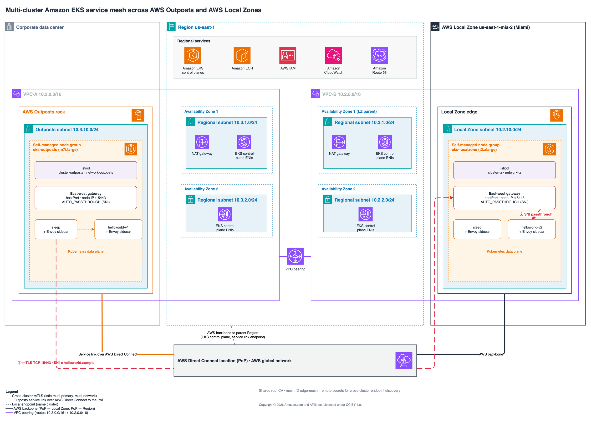
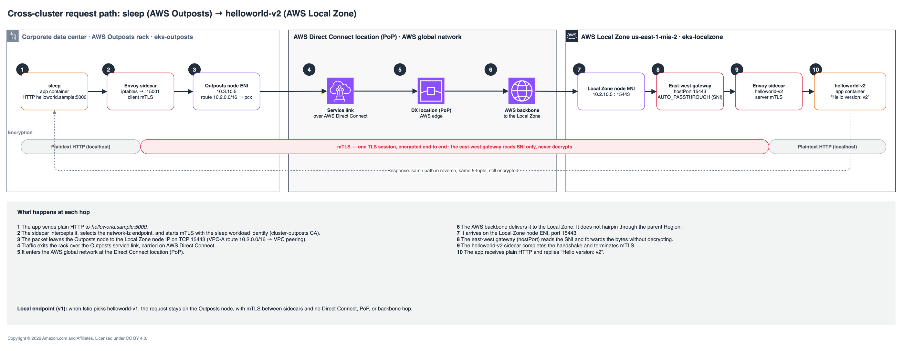

# Architecture

## Components

| Location | What runs there |
|---|---|
| Region (us-east-1) | Both EKS control planes, the regional subnets of both VPCs (control plane ENIs, NAT gateways), the VPC peering connection |
| Outposts rack | Outposts subnet `10.3.10.0/24`: self-managed nodes for `eks-outposts`, istiod (`cluster-outposts`, `network-outposts`), east-west gateway on the node IP, workloads |
| Local Zone | Local Zone subnet `10.2.10.0/24`: self-managed nodes for `eks-localzone`, istiod (`cluster-lz`, `network-lz`), east-west gateway on the node IP, workloads |
| AWS Direct Connect location (PoP) | Where the Outposts service link enters the AWS global network |

The two clusters form one mesh (`edge-mesh`). Each cluster is its own Istio network. Pods never route to remote Pod
IPs directly; cross-cluster calls always go through the destination network's east-west gateway.

## Request path

1. The client app sends plain HTTP to `helloworld.sample:5000`.
2. Its sidecar picks an endpoint in `network-lz` and starts mTLS with the client's workload identity.
3. The packet leaves the Outposts node for the Local Zone gateway node IP on TCP 15443. VPC-A routes `10.2.0.0/16` to
   the peering connection.
4. It leaves the rack over the Outposts service link, carried on AWS Direct Connect.
5. It enters the AWS global network at the Direct Connect location.
6. The AWS backbone delivers it to the Local Zone.
7. It arrives on the Local Zone node, port 15443.
8. The east-west gateway reads the SNI and forwards the bytes without decrypting them (`AUTO_PASSTHROUGH`).
9. The destination sidecar completes the handshake and ends mTLS.
10. The app receives plain HTTP.

When Istio picks a local endpoint, the request stays on the Outposts.

## Why these choices

### Two VPCs, two clusters

Each location is its own failure domain. If the service link goes down, the Outposts cluster keeps serving local
traffic with its own istiod, and the Local Zone cluster is unaffected. A single cluster stretched across both
locations would share one control plane and one failure domain.

### hostPort gateway instead of a load balancer

The standard multi-network install exposes the east-west gateway through a `LoadBalancer` Service, which on AWS
creates an NLB. NLBs are not supported on Outposts subnets, and load balancer support varies by Local Zone. The
gateway publishes port 15443 on each gateway node with a hostPort, and meshNetworks lists those node IPs.

The gateway Pod is not on host networking because Istio's sidecar injector skips `hostNetwork` Pods. The proxy
would never be injected and the Pod would stay on the placeholder `auto` image.

The trade-off: a node replacement changes the IP. Re-run `make apply STACK=30-mesh` after a gateway node is replaced,
or automate it (see [security.md](security.md#production-hardening)).

### Public EKS endpoints with a CIDR allow list

Each istiod watches the other cluster's API server through a remote secret. The EKS private endpoint's DNS name only
resolves to private IPs inside the cluster's own VPC, so from the peer VPC the name resolves to the public endpoint.
Traffic leaves through the peer's NAT gateway, and both NAT IPs are on each endpoint's allow list. `0.0.0.0/0` is
rejected by input validation unless you set the lab-only `allow_public_api_from_anywhere`. For production, make the
endpoints private or keep a tight allow list ([security.md](security.md#eks-api-endpoint-access)).

### Plugged-in CA

Workloads in both clusters must trust each other. Both istiods use intermediates signed by one root
(`ISTIO_MULTIROOT_MESH`, `AUTO_RELOAD_PLUGIN_CERTS`). The `mesh-ca` module generates them with the `tls` provider for
lab use. For production, issue them from AWS Private CA and set `create_cacerts = false`.

## Ports

| Port | Direction | Purpose |
|---|---|---|
| TCP 15443 | Peer VPC → gateway nodes | Cross-network mTLS (AUTO_PASSTHROUGH) |
| ICMP | Peer VPC → nodes | Path MTU discovery, troubleshooting |
| TCP 443 | Peer NAT IP → EKS public endpoint | istiod endpoint discovery |
| TCP 15017, 15012, 10250, 443 | Control plane ↔ nodes | Covered by EKS cluster security group membership |
